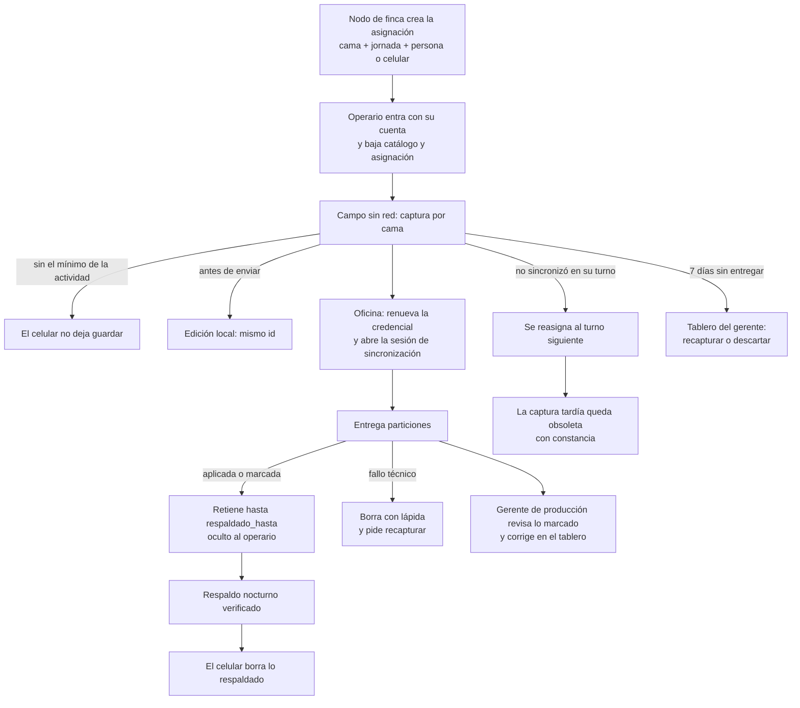

# TX-1 · la jornada vista desde el negocio · event storming, flujo y casos de uso propuestos
Qué es: lo que Juan contó sobre cómo se trabaja una jornada en la finca al detallar TX-1.K, recreado con el formato de `IA_TX1-sincronizacion.md` §7 y §8.
Quién: IA (Claude), 2026-10-18, skill information-pairment, desde `ESPEC-contrato-ingesta.md`, su HISTORIA y el destilado del 17-oct.
Estado: SIN REVISAR
Manda por encima: `IA_TX1-sincronizacion.md` · `ADR.xlsx` (ADR-025, ADR-026) · la palabra de Juan.

Complementa `IA_TX1-sincronizacion.md` §7, que sigue mandando. Las tarjetas llevan `ES-P` para no chocar con `ES-S01`..`ES-S17`.

## 1 · Flujo de la jornada
Juan, 16-oct 19:35: al operario «le mandan lo que tiene que ir a mirar», captura sin internet y sincroniza en la oficina.

## 2 · Event storming
Formato de Juan: estímulo · entorno · qué pasó · cómo lo abordamos · prueba.

### ES-P01 · La mañana no sincronizó y la cama pasa a la tarde
*Juan, 16-oct 20:31: unas 30 personas, turnos de 6 a 2-3 y de 2-4 a 10-11.*
- **Estímulo:** D-014 (turno de la mañana) no sincroniza la cama 12; se reasigna a D-022 (tarde), que la captura y la entrega.
- **Entorno:** jornada normal, la misma orden se cumple dos veces el mismo día.
- **Qué pasó:** después llega la captura de D-014.
- **Cómo lo abordamos:** cuenta `sin_efecto` con `obsoleta`, no se guarda el dato y queda constancia {op-07, cama 12, jornada, superada por D-022}. Si la de D-022 trae cualquier marca, entran las dos marcadas y decide RF-022.
- **Prueba:** C-37, C-71, C-72 de la ESPEC del contrato.

### ES-P02 · Dos operarios comparten un celular
*Juan, 17-oct 03:14: «cuenta única de cada operario», «para eso está en partes».*
- **Estímulo:** op-12 entra con su cuenta en el celular donde op-07 sincronizaba.
- **Entorno:** oficina; una sesión de op-07 a medias.
- **Qué pasó:** quedan pendientes de los dos en el mismo almacén.
- **Cómo lo abordamos:** la sesión de op-07 se cierra `parcial`; op-12 sube todo lo pendiente (lo de op-07 sigue a nombre de op-07) y baja su catálogo y su asignación. **Abierto:** si la cama se reasignó entre ellos en el mismo celular, ¿manda la persona o el celular? (COH-61).
- **Prueba:** C-80.

### ES-P03 · Falta un dato y hay que saber por qué
*Juan, 16-oct 17:21: «una cama, un bloque, un lote, un celular completo que… nunca sincronizó».*
- **Estímulo:** el gerente ve menos de lo asignado.
- **Entorno:** cierre de jornada.
- **Qué pasó:** puede ser corte de red o de luz, partición rechazada, hueco de consecutivos, valor vacío, rechazo por reglas, cama no caminada, celular sin sincronizar o celular perdido.
- **Cómo lo abordamos:** consulta asignado − recibido de ADR-026 (`RF-P01`). Amplía `ES-S17`.
- **Prueba:** `GET` de la lista de camas a rehacer, con un caso por cada causa.

### ES-P04 · Pasan 7 días y una cama no llega
- **Estímulo:** un celular retiene una captura sin entregarla.
- **Entorno:** el nodo de finca responde con normalidad.
- **Qué pasó:** a los 3 días el aviso al operario escala; a los 7 la cama sale en el tablero.
- **Cómo lo abordamos:** el gerente ordena recapturar o descartar; el descarte viaja como aviso `descartada_por_gerente` (`RF-P02`). Nada se borra solo.
- **Prueba:** C-39, C-47.

### ES-P05 · Se restaura el nodo de finca por debajo de lo ya anunciado
- **Estímulo:** se restaura un respaldo hasta el 600 cuando ya se había anunciado `respaldado_hasta = 800`.
- **Entorno:** recuperación tras una falla (ES3).
- **Qué pasó:** algunos celulares ya borraron del 601 al 800.
- **Cómo lo abordamos:** las marcas bajan, los celulares reenvían lo que retienen y sus lápidas, y el nodo de finca calcula la posible pérdida por celular y alerta (`ESC-P02`).
- **Prueba:** C-27, C-40, C-52.

## 3 · Casos de uso propuestos
| ID | Caso de uso | Actor | Incluye |
|---|---|---|---|
| UC-P01 | Decidir sobre lo no entregado a los 7 días | Gerente de producción | UC-S5 |
| UC-P02 | Corregir lo ya registrado | Gerente de producción | UC-S6 |
| UC-P03 | Cerrar un hueco que nunca llegará | Administrador del sistema en la finca | — (C-33) |
| UC-P04 | Cambiar de cuenta en un celular compartido | Operario de campo | UC-S1 |
| UC-P05 | Reasignar una cama al turno siguiente | Gerente de producción o quien asigna (sin definir) | UC-S8 |
