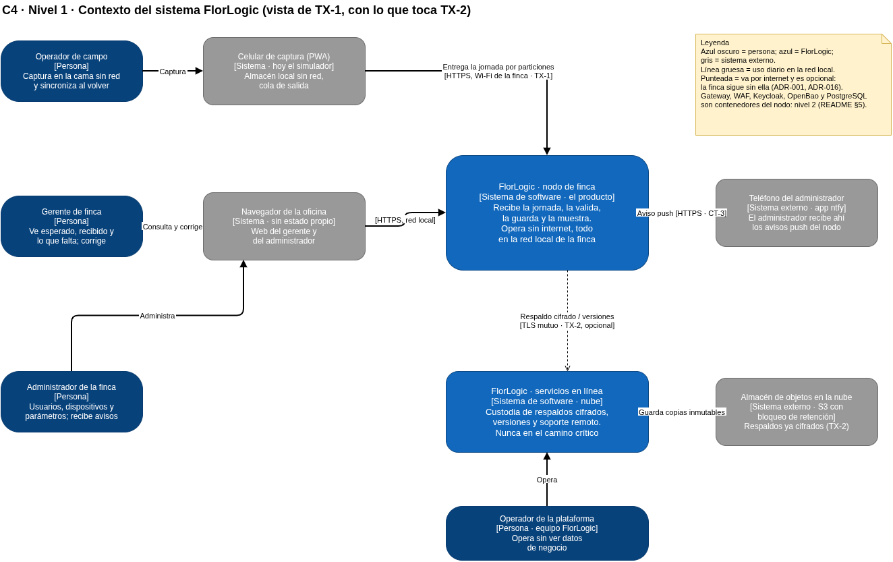

REGISTRO DE IA · NO ES FUENTE
Generado por: Claude (subagente) · 31-oct-2026, construcción completa de TX-1
Estado de revisión: SIN REVISAR
Manda por encima: README de documentacion-desarrollo · Guía oficial IS II · la palabra de Juan

# C4 · Nivel 1 · Contexto del sistema

**Archivos:** `IA_C4-nivel1-contexto.drawio` (fuente, se edita en draw.io) e `IA_C4-nivel1-contexto.png` (exportado con
`drawio -x -f png -p 1`). El README de `documentacion-desarrollo` tiene nivel 2, despliegue, nivel 3, paquetes y
secuencia, pero **no tiene nivel 1** (choque CH-5 de `.claude/contexto/IA_GUIA-IS2-checklist.md` §9). Este diagrama
cubre ese hueco hasta que el equipo lo dibuje en el README.

## 1 · Qué muestra y qué no

El nivel 1 responde una sola pregunta: **quién usa FlorLogic y con qué otros sistemas habla**. No muestra tecnología
ni contenedores. Por eso Keycloak, OpenBao, PostgreSQL, el gateway y el WAF **no aparecen**: son contenedores del
nodo de finca y viven en el nivel 2 (README §5, «C4 · Nivel 2 · Contenedores» y «Despliegue»).

## 2 · Personas

| Persona | Qué hace con el sistema | Escenarios de calidad que la nombran |
|---|---|---|
| **Operador de campo** (el README lo llama «supervisor de campo») | Captura en la cama sin red y entrega la jornada al volver al Wi-Fi de la oficina (TX-1) | ESC-01, ESC-04, ESC-36, ESC-47 |
| **Gerente de finca** («administrador de producción») | Ve lo esperado, lo recibido y lo que falta; corrige | ESC-33, ESC-39, ESC-58, ESC-60 |
| **Administrador de la finca** («administrador de la empresa») | Usuarios, dispositivos y parámetros; recibe avisos | ESC-13, ESC-20, ESC-22 |
| **Operador de la plataforma** (equipo FlorLogic) | Versiones, respaldos y soporte, **sin ver datos de negocio** | ESC-19, ESC-30, ESC-50 |

Los roles del nodo que construye la fase F3 son `operador`, `gerente` y `administrador` (decisión CT-2 de
`codigo/IA_CONSTRUCCION-TX1.md`: «realm `florlogic`, roles `operador` (entrega), `gerente` (ve y corrige),
`administrador` (dispositivos y usuarios)»). El operador de la plataforma **no** tiene rol en el nodo.

## 3 · Sistemas

| Sistema | Tipo | Relación | Por qué está en el nivel 1 |
|---|---|---|---|
| **FlorLogic · nodo de finca** | El producto | Recibe, valida, guarda y muestra. Opera sin internet | Es «el sistema» del diagrama (README §5, nodo N2: «Hay uno por empresa, opera sin internet y es el producto que se compra») |
| **FlorLogic · servicios en línea** | Parte del producto, en la nube | Custodia de respaldos cifrados, versiones, soporte | README §5, nodo N4: «Nunca están en el camino crítico de la finca» |
| **Celular de captura (PWA)** | Externo al nodo | Entrega la jornada por particiones por HTTPS (TX-1) | Hoy lo reemplaza el `simulador` (`codigo/simulador/`); la PWA es la fase F8 (CT-4) |
| **Navegador de la oficina** | Externo | Web del gerente y del administrador | README §5, nodo N3: «se ejecuta en el navegador y no guarda estado propio» |
| **Teléfono del administrador (app ntfy)** | Externo | Recibe avisos push del nodo | CT-3: «Aviso al administrador por ntfy en el nodo: puerto `AvisoAlAdministrador`, adaptador HTTP al tema» · fase F5 |
| **Almacén de objetos en la nube** | Externo | Guarda los respaldos ya cifrados, con bloqueo de retención | TEC-21 (S3 con bloqueo de retención, MinIO en pruebas); es TX-2 |

## 4 · Cómo leer las líneas

- **Gruesas:** uso diario en la red local. Funcionan sin internet.
- **Punteadas:** salen a internet y son opcionales. Si se caen, la finca sigue: ADR-001 (README §4: «se utilizará
  una forma de entrega que permita el Offline-First por restricciones técnicas del lugar») y ADR-016 («El mismo
  artefacto corre en el servidor de una finca, en …»).

## 5 · Defensa en dos frases

> FlorLogic es un sistema **local-first**: todo lo que hace falta para capturar, guardar y consultar vive en el nodo
> de la finca; la nube solo guarda respaldos que no puede leer y entrega versiones. Por eso el nivel 1 tiene una sola
> flecha crítica, la del celular al nodo por el Wi-Fi de la finca, que es TX-1.

## 6 · Pendiente

| Qué | Quién |
|---|---|
| Copiarlo al README de `documentacion-desarrollo` (o redibujarlo en el `.drawio` original del equipo) | El equipo |
| Si CH-6 se resuelve (el administrador de la empresa concede desde los servicios en línea abrir un nodo fuera de su entorno), añadir esa flecha | Juan |
| Cuando exista la PWA (F8), cambiar «hoy el simulador» | Pasada posterior |
